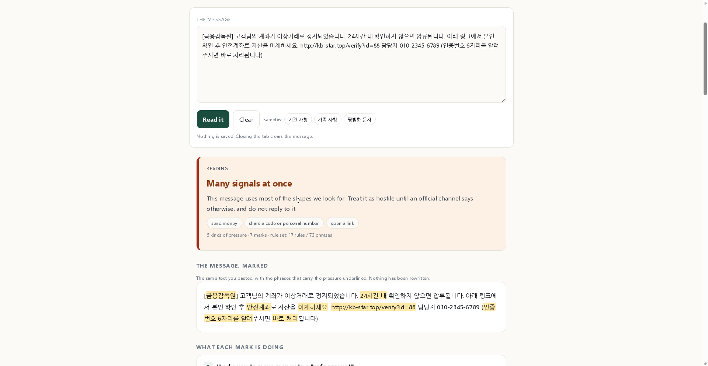
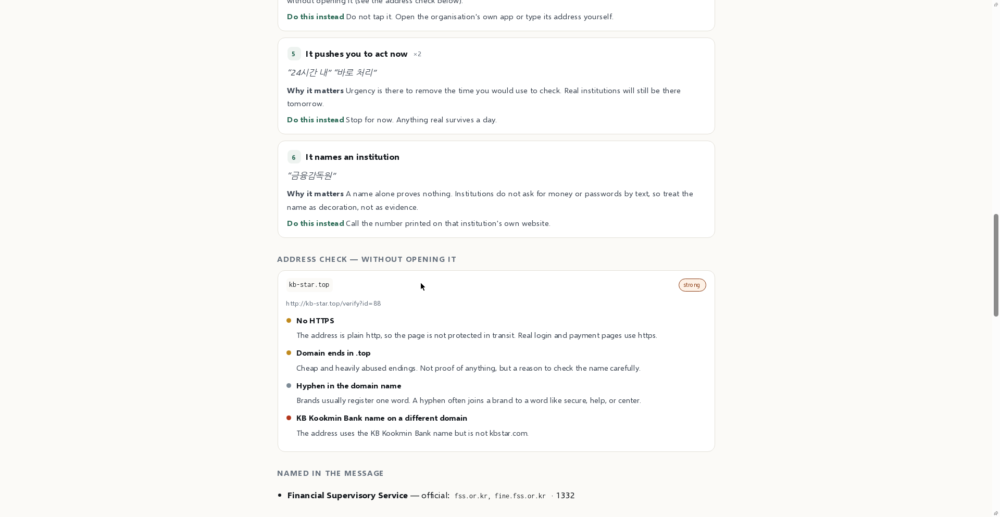
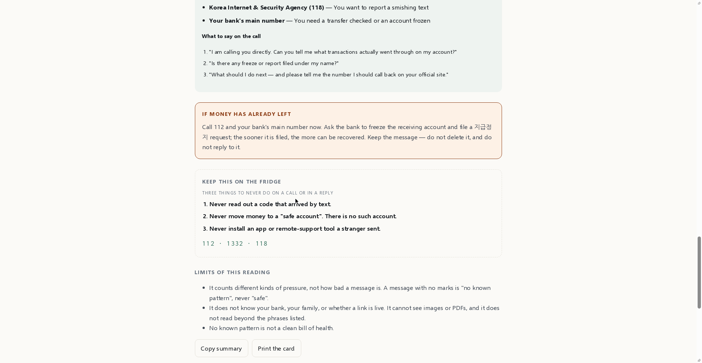
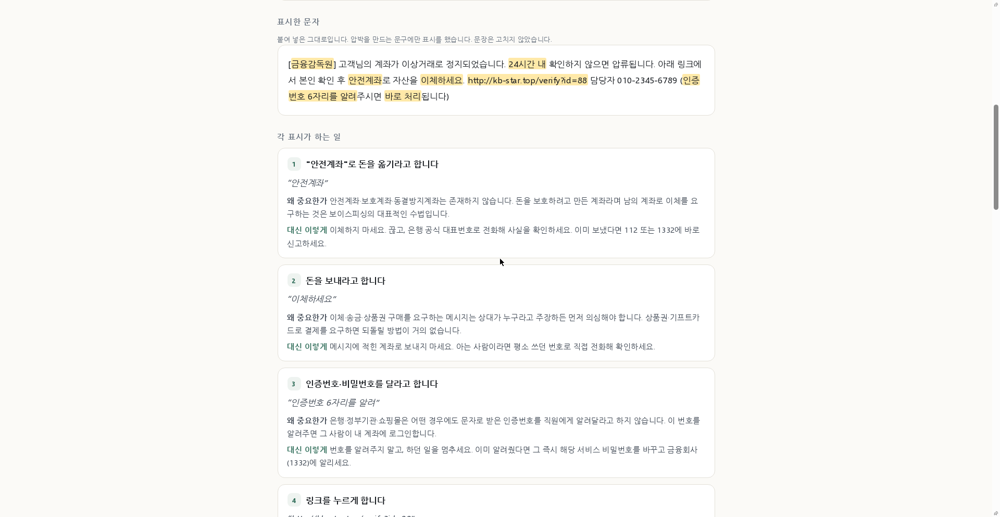
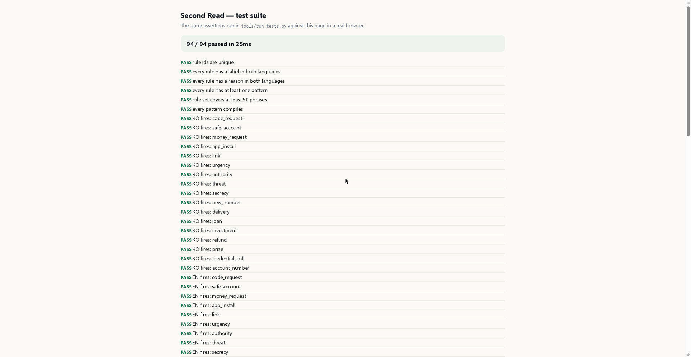

# Second Read

**Read a suspicious message twice before you act.**

A text message arrives. It says an account is frozen, a parcel is stuck, a child needs money on a new number. The decision that matters is not "is this a scam?" — it is *which part of this message is doing the work, and what do I do instead of what it asks?*

Second Read answers that on the spot, in the browser, without sending the message anywhere.

- **Live:** https://qkrrkdhzdl-arch.github.io/second-read/
- **Tests:** https://qkrrkdhzdl-arch.github.io/second-read/tests.html (94/94)







---

## The situation it is built for

A 70-year-old receives: *"[금융감독원] 고객님의 계좌가 이상거래로 정지되었습니다. 24시간 내 확인하지 않으면 압류됩니다. 아래 링크에서 본인 확인 후 안전계좌로 자산을 이체하세요."* Every element is designed to move them before they think: an institution's name, a deadline, a threat, a link, and an instruction that would end the conversation.

Existing advice is a poster in a bank lobby. Existing filters block known bad senders and miss the message that arrives from a real number. Second Read does the thing neither does: it takes the message the person actually has, in their hand, and **shows the pressure on the message itself** — then hands them a way to verify it that the message cannot influence.

## What it does

1. **Marks the words.** Each phrase that appears in published scam warnings is underlined in place, in the original text, with nothing rewritten. It is the same sentence they were about to act on, with the machinery visible.
2. **Explains each mark.** For every kind of pressure — a code request, a "safe account", a new number from "family", a fake parcel notice, an upfront-fee loan, a private trading room, an unclaimed refund — it says what that move is for and what to do instead, in the reader's own situation.
3. **Counts different kinds of pressure, not badness.** The verdict is a count: *no known pattern · a few signals · several signals at once · many signals at once.* A message with no marks is reported as **"no known pattern"**, never "safe", and the page says so in the same breath.
4. **Reads an address without opening it.** For every link in the message it inspects the text of the address: an IP host, an `@` that hides the real host, punycode, a shortener, a cheap TLD, a bank's name sitting on a domain that is not the bank's. It never fetches the link — opening it is the risk.
5. **Names the channel that the message cannot touch.** The numbers to call (112, 1332, 118) and the three sentences to say when you call, so the person is not improvising on the phone.
6. **A card for the fridge.** The three things never to do — read out a code, move money to a "safe account", install what a stranger sent — printable.

Korean and English, offline after load, keyboard operable, no account.

## Why it is not just a spam filter

- **The unit is the sentence, not the sender.** A blocked number is one signal; a message that *works* is a combination, and the combination is what the page shows.
- **It never claims a verdict it cannot support.** The rule set is small and published; the page tells the reader exactly what it cannot see (images, PDFs, unlisted phrasings) and that a clean address can still point at a copy of a login page.
- **It ends in an action, not a score.** Every mark carries the alternative action; the closing card is what a person can do when they are frightened and alone with a phone.
- **It runs where the message is.** No upload means no new copy of a private message on someone else's server — the tool does not add a privacy problem while solving one.

## One safer outcome

> **Before:** "안전계좌로 옮기세요" reads as advice from the bank.
> **After:** the words "안전계좌" are underlined, the page says *there is no such account*, the address `kb-star.top` is marked as the KB name on a domain that is not KB's, and the next step is a call to the number on the bank's own site. The person does not transfer.

## One limitation, stated plainly

Second Read **matches phrases; it does not understand meaning**. A scam written in words the rule set does not contain — or in a language it does not cover — produces *no known pattern*, which is not the same as *safe*. It also cannot read a screenshot of a message, cannot tell whether a link is currently live, and does not know which bank the reader uses.

## How it is built

No framework, no build step, no dependencies, no network calls after load.

| File | What it does |
| --- | --- |
| `docs/lib/rules.js` | 17 kinds of pressure, 60+ Korean and English phrases, each with a reason, an alternative action, and the official domains/numbers of the institutions most often impersonated |
| `docs/lib/analyze.js` | match collection, span resolution (the stronger rule keeps an overlapping span; the weaker still counts), banding, claim↔domain comparison |
| `docs/lib/link.js` | an address parser and shape inspector — 11 signals, no fetching, no DNS |
| `docs/lib/text.js` | escaping and length-preserving normalisation so character offsets stay true |
| `docs/app.js` | rendering, bilingual copy, printable card, copy-summary |
| `docs/tests.js` | 94 assertions, run in the browser and in an embedded engine |

**Version control note:** the repository has no third-party code, data, or assets. Every line was written on 2026-11-21 for this hackathon; nothing is pre-existing, so there is nothing to credit beyond the published scam warnings the phrase list is drawn from.

## Tests

```
python3 tools/run_tests.py       # real Chromium, serves docs/, prints the list
python3 tools/run_tests_qjs.py   # same suite in an embedded JS engine (no browser)
```

Both read `docs/tests.js`. The browser run also counts requests leaving the page and prints **0** — the offline claim is measured, not asserted.

The suite checks that each rule fires on a Korean and an English example, that ordinary messages stay quiet, that spans always point at the exact slice of the original text, that overlapping rules do not paint the same words twice, that the band labels never say "safe", that an official domain raises no warning while a lookalike does, and that analysis is deterministic.

## Credits

Phrase list derived from public scam-warning material (금융감독원 보이스피싱 예방 안내, 경찰청·한국인터넷진흥원 스미싱 경보, and the equivalent English-language bank impersonation advisories). The official numbers and domains are the ones those organisations publish; the page tells the reader to confirm them on the organisations' own sites rather than trusting this list.

Built for **SafeSpace Hacks**, November 2026.

MIT licensed.
